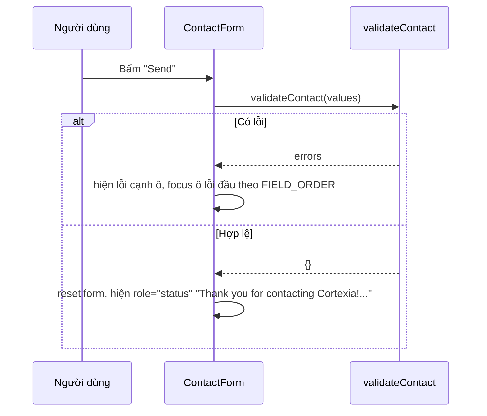

# Tài liệu Design: Site Cortexia trên Next.js theo template Cruip

## Tổng quan

Copy mã nguồn Template (`../_template/open-react-template`, Next.js 15.1, React 19, Tailwind CSS 4, AOS) vào gốc repo `cortexia`, bỏ phần auth/API/nội dung mẫu, rồi dựng 5 trang Cortexia bằng các khối của Template. Thông tin thương hiệu nằm trong `config/site.ts`. Số liệu, case study, lời chứng thực ngành Digital nằm trong `content/digital.ts`. Văn bản giữ từ Site cũ nằm trong `content/pages.ts`. Build bằng `output: 'export'` ra thư mục `out/`. Sau build, script `scripts/check-build.mjs` kiểm tra thương hiệu, SEO, liên kết và tài nguyên. Xong thì xoá mã Site cũ. Đáp ứng [requirements.md](./requirements.md).

## Kiến trúc

```mermaid
flowchart LR
  C1[config/site.ts<br/>thông tin thương hiệu] --> L[app/layout.tsx<br/>metadata gốc, Header]
  C2[content/pages.ts<br/>văn bản Site cũ] --> P[app/(default)/*/page.tsx<br/>5 trang]
  C3[content/digital.ts<br/>số liệu, case study, testimonials] --> P
  C1 --> F[components/ui/footer.tsx]
  P --> S[components/sections/*<br/>khối của Template]
  L --> B[next build<br/>output: export]
  P --> B
  B --> O[out/<br/>Bản build tĩnh]
  O --> K[scripts/check-build.mjs]
```

- Root layout `app/layout.tsx` giữ font Inter + Nacelle và nền tối của Template, đặt `metadataBase = https://digitalcortexia.com`, `lang="en"`, render `Header`.
- Layout `app/(default)/layout.tsx` khởi tạo AOS (tắt khi `prefers-reduced-motion`), render `main` và `Footer`.
- Mỗi trang là Server Component, export `metadata` riêng lấy qua helper `pageMetadata()`.
- Chỉ `Header`, `ContactForm` và layout AOS là Client Component.
- Xoá khỏi Template: `app/(auth)/**`, `app/api/**`, `components/modal-video.tsx`, `public/videos/**`, `public/images/testimonial-*.jpg`, `client-logo-*.svg`, `hero-image-01.jpg`, `features.png`, `workflow-0*.png`, `public/favicon.ico`.

## Thành phần và giao diện

### Khai báo thương hiệu

- Vị trí: `config/site.ts`
- Trách nhiệm: nguồn duy nhất cho tên, tên miền, URL, địa chỉ, email, điện thoại, mã số thuế, danh sách menu (2.4).

```ts
export type SiteConfig = {
  name: "Cortexia";
  domain: "digitalcortexia.com";
  url: "https://digitalcortexia.com";
  address: string;      // "Tầng 6, tòa C, 22 Thành Công, Ba Đình, Hà Nội"
  email: string;        // "" ở bản đầu (2.7)
  phone: string;        // "" ở bản đầu; dạng hiển thị, ví dụ "+84 9xx xxx xxx"
  taxId: string;        // "" ở bản đầu
};
export const site: SiteConfig;
export const navLinks: { href: "/" | "/about" | "/services" | "/portfolio" | "/contact"; label: string }[];
```

### Helper liên hệ và metadata

- Vị trí: `lib/contact.ts`, `lib/metadata.ts`
- Trách nhiệm: lọc mục liên hệ rỗng (2.5, 2.6) và sinh metadata tuyệt đối (5.1, 5.2).

```ts
// lib/contact.ts
type ContactItem = { kind: "address" | "email" | "phone" | "taxId"; label: string; value: string; href?: string };
export function contactItems(cfg: SiteConfig): ContactItem[];
// bỏ mục có value.trim() === ""; email → href "mailto:<email>"; phone → href "tel:<chỉ chữ số và dấu +>"

// lib/metadata.ts
export function pageMetadata(p: { path: string; title: string; description: string }): Metadata;
// title, description, alternates.canonical = site.url + path, openGraph { type: "website", url, title, description }
```

Component `components/ui/contact-list.tsx` render `contactItems(site)` thành `<ul>`, mỗi mục có biểu tượng SVG `aria-hidden` và nhãn. Footer và trang Contact cùng dùng component này.

### Header

- Vị trí: `components/ui/header.tsx` (sửa từ Template), `components/ui/logo.tsx` (wordmark "Cortexia").
- Bỏ nút Sign In/Register, thay bằng menu 5 liên kết từ `navLinks` và nút "Contact Us".
- `usePathname()` xác định trang đang xem: liên kết đó có `aria-current="page"` và màu `text-indigo-400`, còn lại `text-gray-300` (3.5).
- Dưới `md` (768px): ẩn menu, hiện nút `aria-expanded`/`aria-controls` mở panel chứa đủ 5 liên kết. Bấm liên kết hoặc phím Escape thì đóng (3.4).

```ts
export function isActive(pathname: string, href: string): boolean; // "/" chỉ khớp "/", còn lại so sánh sau khi bỏ "/" cuối
```

### Footer

- Vị trí: `components/ui/footer.tsx` (sửa từ Template).
- Cột "Quick Links" (5 trang), cột "Services" (6 dịch vụ, trỏ `/services`), cột "Contact Us" (`ContactList`), logo, dòng `© <năm> Cortexia`. Bỏ icon mạng xã hội mẫu.

### Khối nội dung

- Vị trí: `components/sections/`
- Dựng lại từ component của Template, nhận dữ liệu qua props, không chứa chữ cố định:

| Component | Nguồn Template | Dùng ở |
|---|---|---|
| `page-hero.tsx` | `hero-home.tsx` (bỏ video) | 5 trang, chứa `h1` duy nhất |
| `stats.tsx` | lưới số của `features.tsx` | Trang chủ, About |
| `feature-grid.tsx` | `features.tsx` | Dịch vụ, giá trị, quy trình |
| `case-studies.tsx` | thẻ của `workflows.tsx` + `spotlight.tsx` | Services, Portfolio |
| `testimonials.tsx` | `testimonials.tsx` (bỏ ảnh, bỏ bộ lọc danh mục) | Trang chủ, About |
| `cta.tsx` | `cta.tsx` | cuối 5 trang (1.3) |
| `page-illustration.tsx` | giữ nguyên | nền trang trí |

### Trang

| URL | File | Nội dung |
|---|---|---|
| `/` | `app/(default)/page.tsx` | hero, stats, Core services, Built on..., Proven..., testimonials, CTA "Ready to Elevate Your Engineering Capabilities?" |
| `/about` | `app/(default)/about/page.tsx` | hero "About Cortexia", các khối giới thiệu, stats, testimonials, CTA "Looking for a Dependable Engineering Partner?" |
| `/services` | `app/(default)/services/page.tsx` | 6 dịch vụ, 2 case study, quy trình, CTA "Need a Tailored Technical Proposal?" |
| `/portfolio` | `app/(default)/portfolio/page.tsx` | 1 case study nổi bật + 6 case study, CTA "Have a Similar Project in Mind?" |
| `/contact` | `app/(default)/contact/page.tsx` | hero "Get in Touch with Cortexia", `ContactList`, `ContactForm`, các bước tiếp nhận |
| 404 | `app/not-found.tsx` | giao diện Template, nút về `/` |

Các `h1` phụ của Site cũ (ví dụ "Core ...", "Built on ...") chuyển thành `h2` để mỗi trang chỉ có một `h1` (5.5). Câu chữ giữ nguyên văn.

### Form liên hệ

- Vị trí: `components/contact-form.tsx` (Client), `lib/validate-contact.ts` (hàm thuần).
- Trường: `name` (Name, bắt buộc), `phone` (Phone Number), `email` (Business Email, bắt buộc), `service` (select 6 lựa chọn như Site cũ), `message` (Message, bắt buộc). Mỗi ô có `<label htmlFor>`.
- Form dùng `noValidate`, tự kiểm tra bằng `validateContact`. Ô lỗi có `aria-invalid="true"` và `aria-describedby` trỏ tới thông báo lỗi ngay dưới ô. Focus vào ô lỗi đầu tiên theo thứ tự name → email → message.
- Gửi hợp lệ: reset state, hiện khối `role="status"` với câu cảm ơn ở 6.2. Không gọi mạng.

```ts
export type ContactInput = { name: string; phone: string; email: string; service: string; message: string };
export type ContactErrors = Partial<Record<"name" | "email" | "message", string>>;
export const EMAIL_RE = /^[^\s@]+@[^\s@]+\.[^\s@]+$/;
export function validateContact(input: ContactInput): ContactErrors;
export const FIELD_ORDER = ["name", "email", "message"] as const;
```

### SEO tĩnh

- `app/sitemap.ts` và `app/robots.ts` (có `export const dynamic = "force-static"`) sinh `sitemap.xml`, `robots.txt` từ `site.url` và `navLinks` (5.3).
- `public/CNAME` chứa `digitalcortexia.com` (5.4).
- `app/icon.svg`: favicon chữ "C" theo gradient Template. `app/opengraph-image.tsx`: ảnh OG 1200×630 sinh bằng `ImageResponse` lúc build, có wordmark Cortexia (2.2).

### Kiểm tra sau build

- Vị trí: `scripts/check-build.mjs`, chỉ dùng Node built-in. Lệnh `pnpm check` chạy sau `pnpm build`.
- Với mỗi file HTML trong `out/` (5 trang + `404.html`):
  - `<html lang="en">`, đúng 1 `<h1`.
  - Có `og:type`, `og:url`, `og:title`, `og:description`, `og:image`. URL og và canonical bắt đầu bằng `https://digitalcortexia.com`.
  - Mọi `src`, `href`, `srcset` nội bộ trỏ tới file có thật trong `out/`.
  - Không có `alert(`. Mọi `` có `alt`.
- Toàn bộ `out/` và mã nguồn (`app components config content lib public`): 0 lần xuất hiện `dvtechnic` (không phân biệt hoa thường), `OpenClaw`, `Hermes`, `CDR`, `Open PRO`, `Cruip`.
- `out/sitemap.xml` có đúng 5 `<loc>` khớp 4.1. `out/robots.txt` có dòng sitemap. `out/CNAME` đúng nội dung.
- Có lỗi thì in danh sách và thoát mã 1.

## Mô hình dữ liệu

```ts
// content/digital.ts
/** NỘI DUNG MẪU: số liệu, case study và lời chứng thực dưới đây do AI soạn,
 *  chủ site PHẢI xác nhận tính đúng trước khi phát hành. */
export type Stat = { value: string; label: string };              // đúng 4 phần tử
export type CaseStudy = {
  slug: string; name: string; industry: string; summary: string;
  technologies: string[]; results: { metric: string; label: string }[]; // results.length >= 1, metric có chữ số
};
export type Testimonial = { quote: string; role: string; companyType: string }; // không có tên người/công ty
export const stats: Stat[];
export const featuredCase: CaseStudy;          // thay "Carrier-Grade Telecom CDR..." ở Portfolio
export const portfolioCases: CaseStudy[];      // 6 phần tử, thay 6 dự án Portfolio
export const serviceCases: CaseStudy[];        // 2 phần tử, thay OpenClaw/Hermes ở Services
export const testimonials: Testimonial[];      // cùng số lượng lời chứng thực của Site cũ

// content/pages.ts: văn bản giữ nguyên của Site cũ (tiêu đề, đoạn văn, dịch vụ, quy trình, CTA, meta)
export const home, about, services, portfolio, contact; // mỗi object có meta { title, description }
export const serviceList: { slug: string; title: string; summary: string; bullets: string[] }[]; // 6 dịch vụ
```

Ảnh: 6 ảnh dịch vụ trung tính của Site cũ (`images/services/service-*.jpg`) chuyển sang `public/images/services/`. Case study không dùng ảnh mà dùng thẻ gradient của Template. Mọi ảnh/logo DVTechnic, OpenClaw, Hermes bị xoá.

## Luồng xử lý chính



## Correctness properties

### Phân loại tiêu chí chấp nhận

| Tiêu chí | Loại | Ghi chú |
|---|---|---|
| 1.1 | Ví dụ | `check-build`: tồn tại 5 file HTML |
| 1.2 | Ví dụ | Unit test so khớp tiêu đề/đoạn văn trích từ Site cũ (fixture `tests/fixtures/legacy-text.json`, tạo trước khi xoá Site cũ) với HTML build |
| 1.3 | Ví dụ | `check-build`: mỗi trang có tiêu đề CTA tương ứng và link `/contact` |
| 1.4 | Ví dụ | `check-build`: không có "Open PRO", "Cruip", file ảnh/video mẫu |
| 2.1 | Ví dụ | `check-build`: quét chuỗi "dvtechnic" |
| 2.2 | Ví dụ | Unit test Header/Footer render `Logo`. `check-build`: có `icon.svg` và `og:image` |
| 2.3 | Ví dụ | Unit test: Footer và trang Contact chứa địa chỉ |
| 2.4 | Không tự động hoá được | Ràng buộc cấu trúc mã. Kiểm tra qua review và quét: thông tin liên hệ không xuất hiện dạng literal ngoài `config/site.ts` |
| 2.5 | Property | → P1 |
| 2.6 | Property | → P1 |
| 2.7 | Ví dụ | Unit test: `site.email`, `site.phone`, `site.taxId` bằng `""` |
| 3.1 | Không tự động hoá được | Cảm nhận giao diện. Review trực quan so với Template |
| 3.2 | Không tự động hoá được | Review trực quan |
| 3.3 | Biên | Kiểm tra thủ công ở 360, 768, 1280, 1920px (DevTools). Ghi kết quả vào README |
| 3.4 | Ví dụ | Unit test Header: nút menu đổi `aria-expanded` và hiện 5 link |
| 3.5 | Property | → P3 |
| 4.1 | Ví dụ | `check-build` + phục vụ `out/` bằng `npx serve@<ghim> out` (cleanUrls) |
| 4.2 | Ví dụ | `check-build`: mọi `href` nội bộ thuộc tập 5 URL hoặc tài nguyên tồn tại |
| 4.3 | Ví dụ | `check-build`: có `out/404.html` chứa link `/` |
| 5.1 | Ví dụ | `check-build`: đủ thẻ meta/og trên 5 trang |
| 5.2 | Property | → P4 |
| 5.3 | Ví dụ | `check-build`: sitemap 5 URL, dòng robots |
| 5.4 | Ví dụ | `check-build`: `out/CNAME` |
| 5.5 | Ví dụ | `check-build`: `lang="en"`, đúng 1 `h1` |
| 6.1 | Ví dụ | Unit test: 5 trường, mỗi ô có label gắn đúng |
| 6.2 | Ví dụ | Unit test: gửi hợp lệ hiện câu cảm ơn, form rỗng, không gọi `window.alert` |
| 6.3 | Property | → P2 (validation). Unit test cho phần focus |
| 6.4 | Ví dụ | Unit test: trang Contact render các bước quy trình |
| 7.1 | Ví dụ | Chạy `pnpm build` (gồm type-check và lint) |
| 7.2 | Ví dụ | Phục vụ `out/` bằng static server, mở 5 URL |
| 7.3 | Không tự động hoá được | Review README |
| 7.4 | Ví dụ | `check-build`: tài nguyên nội bộ tồn tại. Unit test của script với HTML có ảnh không tồn tại → thoát mã 1 |
| 8.1 | Ví dụ | Unit test: `stats.length === 4`, không chứa "10+", "150+", "50+" |
| 8.2 | Property | → P5 |
| 8.3 | Không tự động hoá được | Không xác định máy được tên thật. Unit test chỉ kiểm tra kiểu `Testimonial` không có trường tên, còn lại review |
| 8.4 | Ví dụ | Unit test: dòng đầu `content/digital.ts` chứa "NỘI DUNG MẪU" |
| 8.5 | Ví dụ | `check-build`: quét OpenClaw, Hermes, CDR |

### Danh sách property

**P1: Hiển thị mục liên hệ theo cấu hình**
*Với mọi* `SiteConfig` sinh ngẫu nhiên, trong đó `email`, `phone`, `taxId` lấy từ `""`, chuỗi chỉ có khoảng trắng hoặc chuỗi hợp lệ, `contactItems(cfg)` chứa mục loại k khi và chỉ khi `cfg[k].trim() !== ""`. Mục email luôn có `href === "mailto:" + email`, mục phone luôn có `href` bắt đầu bằng `tel:` và chỉ gồm chữ số và `+`. Render `ContactList` với cấu hình đó không chứa nhãn hay biểu tượng của mục bị bỏ.
_Kiểm chứng: Requirements 2.5, 2.6_

**P2: Validation form liên hệ**
*Với mọi* `ContactInput` sinh ngẫu nhiên (chuỗi rỗng, khoảng trắng, unicode, email hợp lệ/không hợp lệ), `validateContact(x)` có khoá `name` khi và chỉ khi `x.name.trim() === ""`, có khoá `message` khi và chỉ khi `x.message.trim() === ""`, có khoá `email` khi và chỉ khi email rỗng hoặc không khớp `EMAIL_RE`. `phone` và `service` không bao giờ gây lỗi. Ô được focus là phần tử đầu tiên của `FIELD_ORDER` có trong kết quả.
_Kiểm chứng: Requirements 6.3_

**P3: Đúng một liên kết đang hoạt động**
*Với mọi* pathname thuộc 5 URL (có thể thêm `/` cuối), có đúng một phần tử `l` của `navLinks` với `isActive(pathname, l.href) === true`, và đó là trang tương ứng. *Với mọi* pathname ngẫu nhiên khác 5 URL đó, không có liên kết nào active.
_Kiểm chứng: Requirements 3.5_

**P4: Metadata tuyệt đối**
*Với mọi* path bắt đầu bằng `/` cùng title/description bất kỳ, `pageMetadata()` trả `canonical` và `openGraph.url` bắt đầu bằng `https://digitalcortexia.com` và kết thúc bằng path, `openGraph.type === "website"`.
_Kiểm chứng: Requirements 5.2_

**P5: Case study đủ trường**
*Với mọi* case study trong `featuredCase`, `portfolioCases`, `serviceCases`, các trường `name`, `industry`, `summary` khác rỗng, `technologies.length >= 1`, `results.length >= 1`, mỗi `metric` chứa ít nhất một chữ số. Đồng thời `portfolioCases.length === 6`, `serviceCases.length === 2`.
_Kiểm chứng: Requirements 8.2_

## Xử lý lỗi

| Tình huống | Cách phát hiện | Phản hồi / mã lỗi | Requirement |
|---|---|---|---|
| Gửi form thiếu trường bắt buộc hoặc email sai | `validateContact` trả lỗi | Lỗi dưới ô, `aria-invalid`, focus ô lỗi đầu, không reset | 6.3 |
| Email/phone/taxId trống | `contactItems` bỏ mục | Không render mục đó | 2.5 |
| URL không tồn tại | GitHub Pages trả `404.html` | Trang 404 của Template, link về `/` | 4.3 |
| Ảnh/font tham chiếu không tồn tại | `check-build` | In đường dẫn lỗi, thoát mã 1 | 7.4 |
| Còn chuỗi cấm (dvtechnic, OpenClaw...) | `check-build` | In file và dòng, thoát mã 1 | 2.1, 8.5 |
| Lỗi TypeScript/ESLint | `next build` | Build thất bại | 7.1 |
| `prefers-reduced-motion: reduce` | `matchMedia` khi khởi tạo AOS | `AOS.init({ disable: true })`, phần tử hiện ngay | Phi chức năng 4 |

## Bảo mật

- Site tĩnh, không có endpoint, không có xác thực. Form không gửi dữ liệu nên không có rủi ro lưu trữ dữ liệu cá nhân.
- Giá trị form chỉ render qua JSX (React tự escape), không dùng `dangerouslySetInnerHTML`.
- Link ngoài (nếu có) dùng `rel="noopener noreferrer"`.
- Dependency ghim chính xác. Tăng `next` lên bản vá mới nhất của nhánh 15.x tại thời điểm làm task (Template đang dùng 15.1.11), tra advisory trước khi ghim.

## Chiến lược kiểm thử

- Property-based test: `fast-check` chạy trên `vitest`, tối thiểu 100 lần chạy mỗi property (`numRuns: 100`). P1 đến P5 mỗi cái là một test riêng trong `tests/properties/`.
- Unit test: `vitest` + `@testing-library/react` + `jsdom` cho Header (3.4), Footer/ContactList (2.2, 2.3), ContactForm (6.1, 6.2, focus của 6.3), nội dung (2.7, 8.1, 8.4), và `check-build` với fixture HTML lỗi (7.4).
- Kiểm tra bản build: `pnpm build && pnpm check` chạy `scripts/check-build.mjs` trên `out/`. Test 1.2 đọc `tests/fixtures/legacy-text.json` (trích h1–h3, đoạn văn và danh sách dịch vụ từ 5 file HTML cũ, đã bỏ phần thuộc Requirement 8 và đổi tên thương hiệu) rồi so với text của `out/*.html`.
- Thủ công: Lighthouse mobile cho 5 trang trên bản `out/` phục vụ local (Phi chức năng 1). Kiểm tra độ rộng 360–1920px (3.3). Điều hướng bằng bàn phím (Phi chức năng 3). Bật reduced motion (Phi chức năng 4). Ghi kết quả vào README.
- Lệnh: `pnpm dev`, `pnpm build`, `pnpm lint`, `pnpm test` (`vitest run`), `pnpm check`.

## Quyết định thiết kế và đánh đổi

- **Copy Template vào gốc repo**, không dùng submodule hay thư mục con: GitHub Pages deploy từ `out/` và repo chỉ còn một site.
- **`trailingSlash: false`** (mặc định): export ra `about.html`. GitHub Pages phục vụ `/about` từ `about.html`, giữ đúng URL ở 4.1. Đánh đổi: static server không hỗ trợ clean URL sẽ cần `/about.html`. Kiểm tra 7.2 dùng `serve` (mặc định bật cleanUrls).
- **`images: { unoptimized: true }`**: bắt buộc khi static export với `next/image`.
- **Favicon và ảnh OG sinh bằng code** (`icon.svg`, `opengraph-image.tsx`) vì chưa có logo. Có logo thì thay hai file này và `logo.tsx`.
- **Tách văn bản ra `content/pages.ts`**: component chỉ lo bố cục, dễ đối chiếu với Site cũ (1.2) và dễ quét chuỗi cấm.
- **ESLint**: Template chưa có cấu hình, thêm `eslint` + `eslint-config-next` (flat config `eslint.config.mjs`) để `next build` chạy lint (7.1).
- **Test**: thêm `vitest`, `@vitejs/plugin-react`, `jsdom`, `@testing-library/react`, `fast-check` vì dự án chưa có test.
- **Ghim phiên bản**: chuyển các dải `^` của Template sang phiên bản chính xác đang có trong `pnpm-lock.yaml`. Dependency mới ghim bản ổn định hiện hành khi cài (Phi chức năng 5).
- **Xoá Site cũ ở task cuối**, sau khi đã trích `legacy-text.json` và build đạt.

## Truy vết requirements

| Requirement | Đáp ứng bởi |
|---|---|
| 1.1 | 5 file `app/(default)/*/page.tsx` |
| 1.2 | `content/pages.ts` + test so khớp `legacy-text.json` |
| 1.3 | `components/sections/cta.tsx` trên 5 trang |
| 1.4 | Xoá file mẫu, `check-build` quét chuỗi |
| 2.1 | Thay thương hiệu toàn bộ, `check-build` |
| 2.2 | `logo.tsx`, `app/icon.svg`, `app/opengraph-image.tsx` |
| 2.3 | `ContactList` ở Footer và Contact |
| 2.4 | `config/site.ts` |
| 2.5 | `lib/contact.ts` (`contactItems`), P1 |
| 2.6 | `lib/contact.ts`, P1 |
| 2.7 | `config/site.ts` để trống |
| 3.1 | Giữ `app/css/**`, font Nacelle, AOS của Template |
| 3.2 | `components/sections/*` |
| 3.3 | Layout responsive của Template, kiểm tra thủ công |
| 3.4 | `header.tsx` menu di động |
| 3.5 | `isActive` + `aria-current`, P3 |
| 4.1 | App Router + static export |
| 4.2 | `navLinks`, `check-build` |
| 4.3 | `app/not-found.tsx` |
| 5.1 | `lib/metadata.ts`, metadata mỗi trang |
| 5.2 | `metadataBase`, `pageMetadata`, P4 |
| 5.3 | `app/sitemap.ts`, `app/robots.ts` |
| 5.4 | `public/CNAME` |
| 5.5 | `app/layout.tsx`, `page-hero.tsx` (h1 duy nhất) |
| 6.1 | `components/contact-form.tsx` |
| 6.2 | `contact-form.tsx` khối `role="status"` |
| 6.3 | `lib/validate-contact.ts`, P2 |
| 6.4 | `contact/page.tsx` khối quy trình |
| 7.1 | `package.json` scripts, `eslint.config.mjs` |
| 7.2 | `next.config.js` `output: 'export'` |
| 7.3 | `README.md` |
| 7.4 | `scripts/check-build.mjs` |
| 8.1 | `content/digital.ts` `stats` |
| 8.2 | `content/digital.ts` case studies, P5 |
| 8.3 | Kiểu `Testimonial` không có trường tên |
| 8.4 | Ghi chú đầu `content/digital.ts` |
| 8.5 | `check-build` quét chuỗi |
| Phi chức năng 1 | Ảnh tĩnh nhẹ, font local, Lighthouse thủ công |
| Phi chức năng 2 | `alt` cho ảnh nội dung, `alt=""` + `aria-hidden` cho ảnh trang trí, `check-build` |
| Phi chức năng 3 | Class `focus-visible:outline` cho link, nút, ô nhập |
| Phi chức năng 4 | `app/(default)/layout.tsx` khởi tạo AOS |
| Phi chức năng 5 | `package.json` ghim chính xác |

## Phạm vi file

- `app/**`
- `components/**`
- `config/**`
- `content/**`
- `lib/**`
- `utils/**`
- `public/**`
- `scripts/**`
- `tests/**`
- `package.json`
- `next.config.js`
- `next-env.d.ts`
- `tsconfig.json`
- `postcss.config.js`
- `eslint.config.mjs`
- `vitest.config.mts`
- `.gitignore`
- `README.md`
- `index.html`
- `about.html`
- `services.html`
- `portfolio.html`
- `contact.html`
- `css/**`
- `js/**`
- `images/**`
- `fonts/**`
- `CNAME`
- `robots.txt`
- `sitemap.xml`

## Tài liệu tham khảo

- [Next.js Static Exports](https://nextjs.org/docs/app/guides/static-exports)
- [Next.js Metadata API, sitemap, robots, opengraph-image](https://nextjs.org/docs/app/api-reference/file-conventions/metadata)
- [GitHub Pages custom domain (CNAME)](https://docs.github.com/en/pages/configuring-a-custom-domain-for-your-github-pages-site)
- [fast-check](https://fast-check.dev/)
- [AOS](https://github.com/michalsnik/aos)
